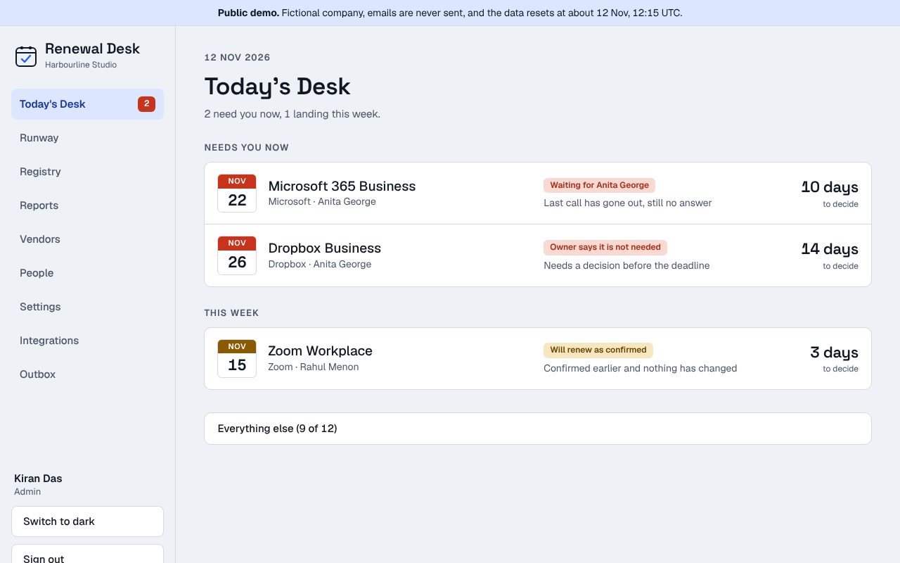
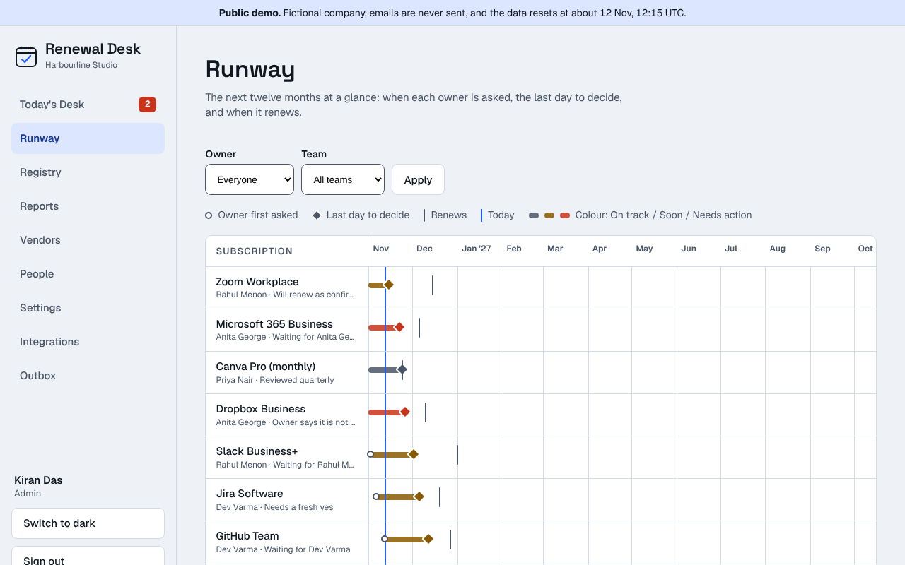
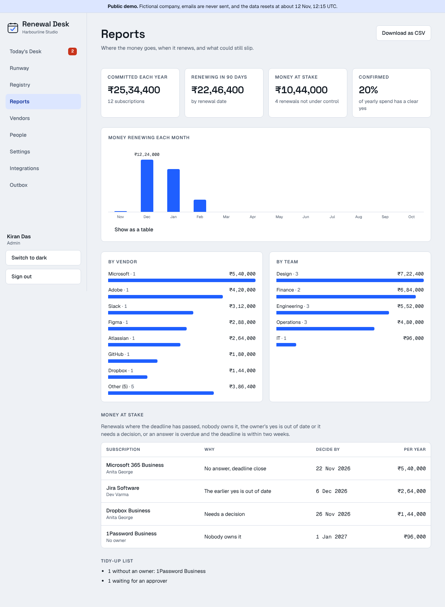

# Renewal Desk

**A subscription renewal workspace built around decisions, owners and cancellation deadlines.**

> A renewal is a decision with a deadline, not just a date on a calendar.

Renewal Desk is an independent software product I initiated and am developing to help teams manage the full lifecycle of software licences and recurring subscriptions. It is designed to move beyond storing renewal dates: the product helps teams identify who must decide, ask them early, follow up when they do not respond, and keep the last day to cancel or change terms visible.

**Product page:** [ajasmhd.in/renewal-desk](https://ajasmhd.in/renewal-desk)  
**Project status:** Working product · Active development  
**Application source:** Private

## The problem

A spreadsheet can record a renewal date. A calendar can send a reminder. Neither makes sure that the right person has confirmed whether a subscription is still needed, or that a decision is made before the cancellation notice period expires.

Renewal Desk treats a renewal as a decision workflow rather than a date-only reminder.

## How it works

1. **Confirm early.** Ask the named owner whether the subscription is still needed, with relevant context and key dates.
2. **Follow up.** Keep track of unanswered requests and escalate them rather than treating silence as approval.
3. **Record the decision.** Capture whether to renew, cancel, replace or change the subscription, with a traceable history.
4. **Protect the deadline.** Make the last day to cancel or change terms the date the workflow is designed around.

## Product capabilities

- Subscription and vendor registry.
- Owner and backup-owner assignment.
- Decision-date calculation using renewal date and notice period.
- Configurable owner confirmation and follow-up workflow.
- Last-call handling and overdue visibility.
- Approval status and decision history.
- 12-month renewal timeline (Runway).
- Reports and CSV export.
- Calendar feed.
- REST API and outbound webhooks.
- Responsive interface and dark mode.
- Fictional-data demo mode designed for safe product exploration.

## Screenshots

Screens below are captured from the built-in demo using fictional sample data. The captured interface date is **12 November 2026**; dates and figures shown are illustrative, not current customer information.

### Today's Desk

### Runway

### Reports

## Product build

I independently identified the problem and initiated the product. My role includes product concept, requirements, workflow design, scope and prioritisation, architecture decisions, implementation direction, review and validation. Development is AI-assisted, with implementation reviewed and tested by me.

**Technology:** Next.js · TypeScript · PostgreSQL · Drizzle ORM · Docker

## Source and availability

The application source code and detailed implementation documentation remain private while the product is being developed as a potential commercial offering. This public project page shares the product concept, selected capabilities and interface examples without publishing the underlying code or sensitive implementation details.

A public hosted demo will be linked from the product page after deployment and external-access safety checks are complete. There is no verified public demo URL at the time of this publication draft.

## Contact

For a product discussion or walkthrough, contact me through [my portfolio](https://ajasmhd.in/#contact).

---

© 2026 Ajas Muhammed. Renewal Desk is an independent product initiative.
